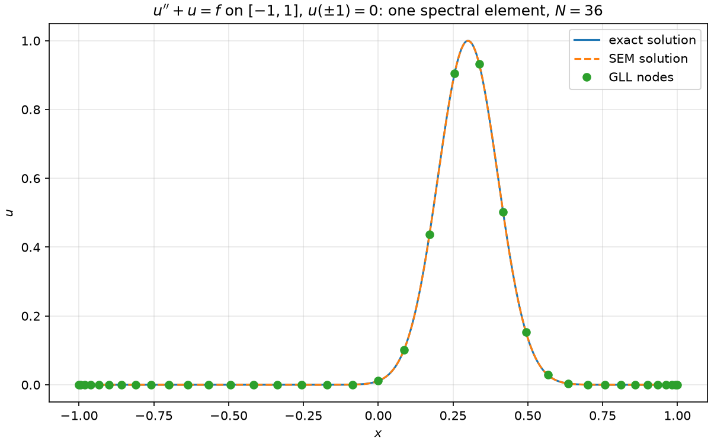
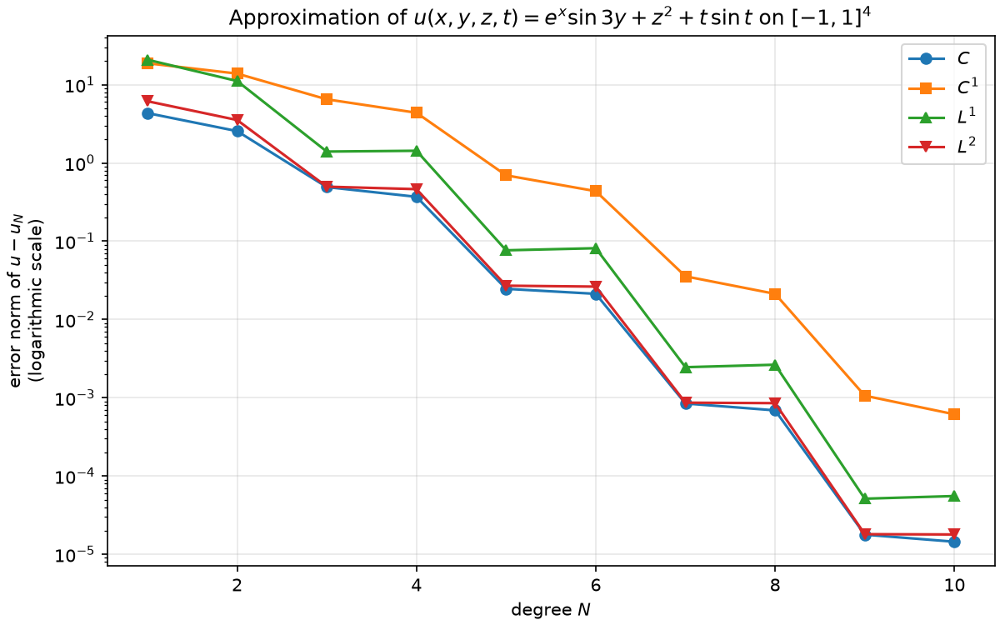
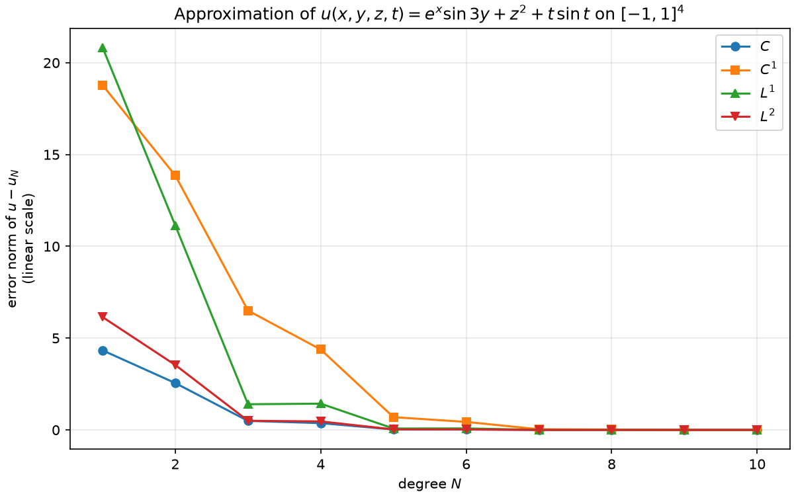

# SpectralElements

A C++20 library for the **spectral element method (SEM)**, built step by step:
nodal Lagrange bases on Gauss–Lobatto–Legendre (GLL) points, tensor-product
operators with sum factorization in up to four dimensions, error norms, a dense
linear solver and plotting through matplotlib.

## Results

### Boundary value problem $u'' + u = f$

One spectral element of degree $N = 36$ on $[-1, 1]$ with $u(\pm 1) = 0$.
The exact solution is a narrow Gaussian peak (manufactured solution). The Galerkin
method with GLL quadrature gives the linear system

$$
\left(D^T W D - W\right)\mathbf{u} = -W\mathbf{f},
$$

where $D$ is the spectral differentiation matrix and $W = \mathrm{diag}(w_i)$ holds the GLL
weights. The error is $\Vert u - u_N \Vert_{L^2} \approx 2 \cdot 10^{-4}$.



### Spectral convergence in 4D

Interpolation of $u(x, y, z, t) = e^{x}\sin 3y + z^2 + t\sin t$ on the reference element
$[-1, 1]^4$ for degrees $N = 1, \dots, 10$ (up to $11^4 = 14\,641$ nodes). All four error
norms decay exponentially: on the logarithmic scale the decay is a straight line. The steps
appear because the dominant part $\sin 3y$ is odd, so on symmetric GLL nodes the accuracy
improves only when an odd degree is added.

<p>
  
  
</p>

## Features

| Module | Contents |
|---|---|
| `core` | `Real`, `Point<Dim>`, `DenseMatrix`, Gaussian elimination with partial pivoting (`solveGauss`), `Timer` |
| `basis` | Legendre polynomials; GLL and Gauss quadratures; barycentric `LagrangeBasis1D`; reference element `SpectralBasis1D`; sum-factorization kernels `applyAlong` / `tensorApply`; `TensorBasis<Dim>` for `Dim` = 1…4 |
| `analysis` | Error norms $C$, $C^1$, $L^1$, $L^2$ in 1D (several elements) and on the reference element in `Dim` dimensions |
| `io` | Line plots (`Figure`), heatmaps / contours / surfaces (`Figure2D`), several windows at once (`renderAll`); drawn by `tools/plot.py` |

## Building

Requirements:

- a C++20 compiler (tested with GCC 15.2, MinGW-w64 bundled with CLion);
- CMake 3.25 or newer (Ninja recommended);
- Python 3 with `matplotlib` and `numpy` — only to draw plots, not to build.
  The interpreter is found automatically or set with `-DSEM_PYTHON_EXECUTABLE=...`.

[Catch2](https://github.com/catchorg/Catch2) for the unit tests is downloaded automatically.

```bash
cmake --preset release
cmake --build --preset release
ctest --preset release
```

In CLion, open the folder and choose the `Release (-O3)` profile from `CMakePresets.json`.

## Examples

| Target | What it shows |
|---|---|
| `example_plot_basis` | Lagrange basis on GLL nodes and spectral convergence of interpolation |
| `example_approximation_1d` | Approximation on $K$ elements: mapping to the reference element, $h$-convergence |
| `example_differential_equation_1d` | Galerkin solution of $u'' + u = f$, $u(\pm 1) = 0$ |
| `example_approximation_4d` | Interpolation on $[-1, 1]^4$, error norms and convergence plots for $N = 1, \dots, 10$ |

Every example opens matplotlib windows; with `--no-show` it only saves the images.

## Regenerating the images

The images in `docs/images` are produced by the examples themselves:

```bash
cmake --build --preset release --target docs_images
```

## Project layout

```
include/sem/   public headers: core, basis, analysis, io
src/           library sources
tests/         Catch2 unit tests
examples/      example programs
tools/plot.py  plotting script (matplotlib)
docs/images/   images for this README
```
